<div align="center">

# Pioneer CDJ & XDJ Emulator

**Original firmware. Emulated hardware.**

Pioneer DJ players on your computer, from the CDJ-2000 to the NXS2 and XDJ family.

[](LICENSE)
[](#quick-start)
[](https://www.qemu.org/)
[](#not-included)

[Supported players](#supported-players) · [Quick start](#quick-start) · [Documentation](#documentation) · [Mods](docs/mods.md) · [How it works](docs/how-it-works.md)

<table>
  <tr>
    <td align="center"><a href="docs/img/decks/cdj2000nxs2.png">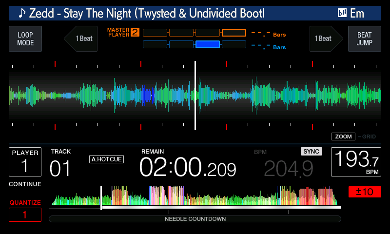</a><br><sub>CDJ-2000NXS2</sub></td>
    <td align="center"><a href="docs/img/decks/xdj1000.png">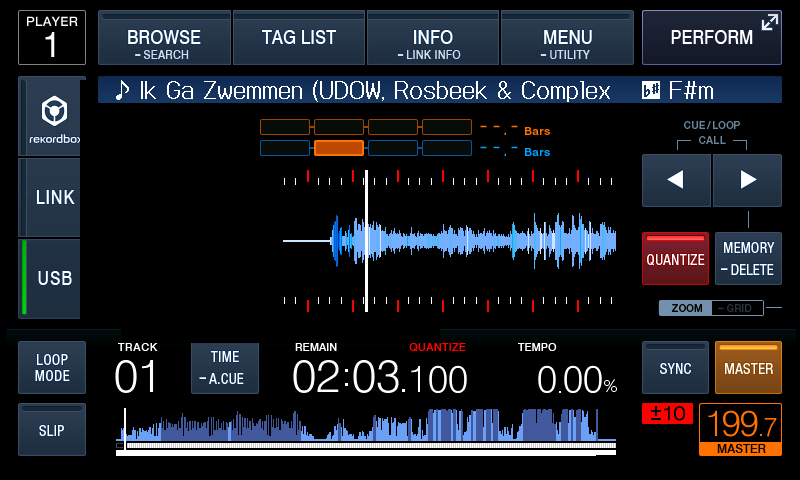</a><br><sub>XDJ-1000</sub></td>
    <td align="center"><a href="docs/img/decks/xdj700.png">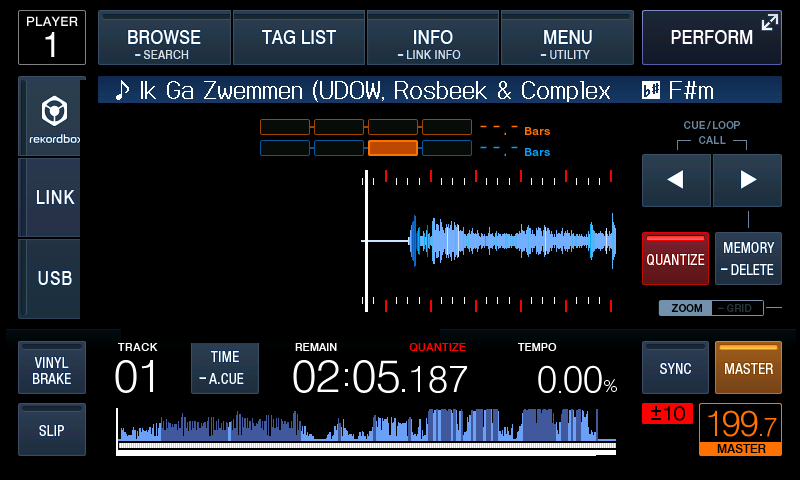</a><br><sub>XDJ-700</sub></td>
  </tr>
  <tr>
    <td align="center"><a href="docs/img/decks/cdj900nxs.png">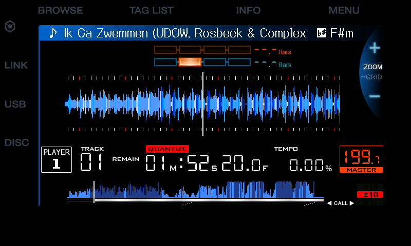</a><br><sub>CDJ-900NXS</sub></td>
    <td align="center"><a href="docs/img/decks/cdj2000nxs.png">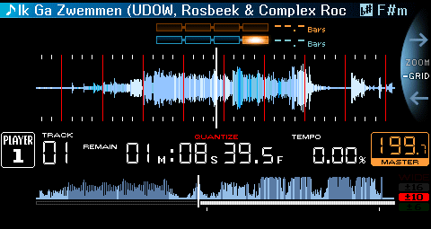</a><br><sub>CDJ-2000NXS</sub></td>
    <td align="center"><a href="docs/img/decks/cdj2000.png">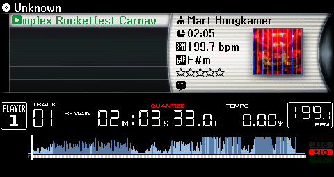</a><br><sub>CDJ-2000</sub></td>
  </tr>
</table>

<sub>Screens captured from the emulator. Select one for full size.</sub>

</div>

The **CDJ-2000NXS2** boots, mounts a virtual USB stick, and loads and plays tracks from it. The waveform
scrolls, the time counts down, and the sound you hear is computed by the
player's own DSP program on an emulated DSP. Start two and they find each other
on an emulated Pro DJ Link network, where MASTER and SYNC work between them.
Plug in a MIDI controller and it plays them, or use the [virtual deck](docs/using-the-deck.md#virtual-deck).

Seven older players have experimental emulation, with further models in
development. The [status table](#supported-players) separates usable features
from ongoing work.

## Features

These are the CDJ-2000NXS2's; the older players are covered under
[Supported players](#supported-players).

| | |
|---|---|
| 🎛️ **The real firmware** | All three processors of the player run its own code: MAIN, the display board and the audio DSP. |
| 🔊 **The DSP's own sound** | A C66x emulator with a JIT runs the DSP program MAIN uploads at boot; the audio you hear is its output. |
| 📈 **Load and play** | A track from the stick loads and plays; the waveform and playhead move, the time counts down. |
| 🔗 **Pro DJ Link** | Two decks take their own addresses from a small DHCP server, announce themselves, and MASTER and SYNC work between them. |
| 🎚️ **Any MIDI controller** | A profile of what the controller sends plus a mapping to CDJ keys. A Roland DJ-202 mapping is included, with its LEDs mirroring the player's lamps. |
| 🌀 **Jog and touch** | The jog bends the DSP's playback speed through the firmware's own jog engine; a click in the window is a touch on the screen. |
| 🧪 **Built for modding** | Trace any firmware address, watch memory, change it while it runs, call firmware functions, script every input. |

<a id="screenshots"></a>

## Screenshots

<p align="center">
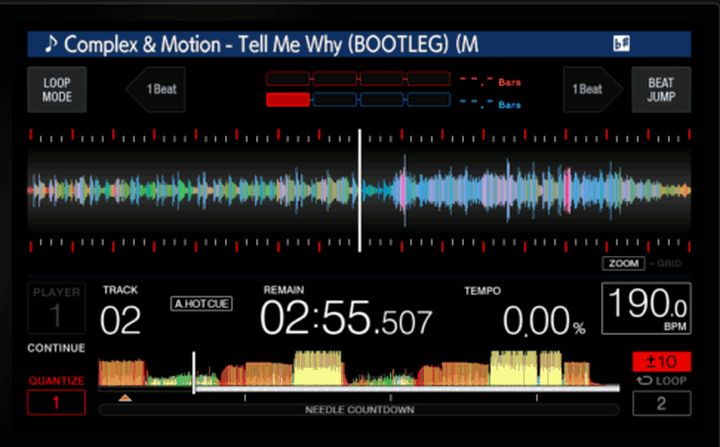
</p>

<p align="center">
<a href="docs/img/hero.png">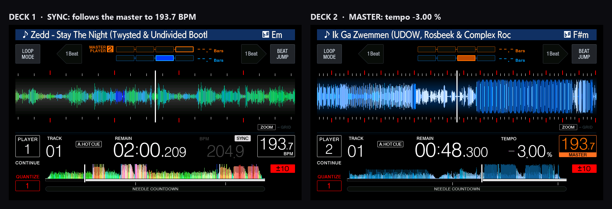</a>
</p>

<details>
<summary><b>More Pro DJ Link screens</b></summary>

<table>
  <tr>
    <td align="center">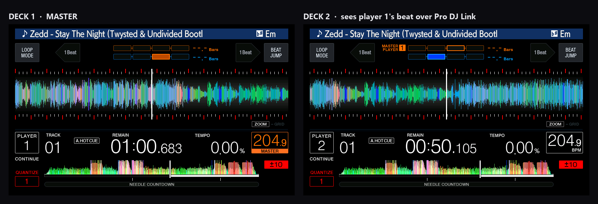<br><sub>Deck 2 tracks the master's beat over Pro DJ Link</sub></td>
    <td align="center">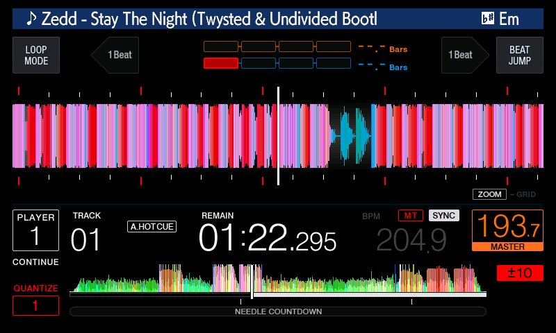<br><sub>MASTER TEMPO and SYNC, colour waveform</sub></td>
  </tr>
  <tr>
    <td align="center">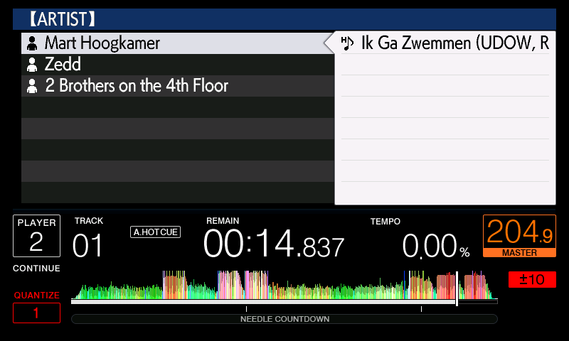<br><sub>Browsing the other player's USB over the link</sub></td>
    <td align="center">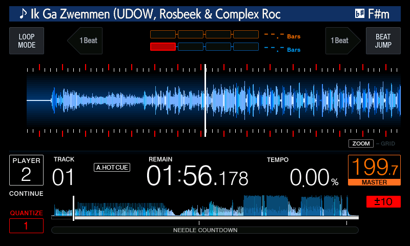<br><sub>...and playing a track loaded from it</sub></td>
  </tr>
</table>

</details>

<a id="supported-players"></a>

## Supported players

The CDJ-2000NXS2 is the fully supported player; the older models are
experimental. Sound is on by default (`NOSOUND=1` turns it off). Screenshots
show the firmware interface, not a claim of feature parity.

| player | status | what works |
|---|---|---|
| **CDJ-2000NXS2** | ✅ Fully supported | Plays tracks from USB in real time with sound. Pro DJ Link, MIDI controllers and [mods](docs/mods.md). |
| **XDJ-1000MK2** | 🧪 Experimental | Loads and plays from USB with the DSP module setup builds; an MP3 breaks up about every 6 s and MASTER TEMPO runs below real time. PLAY, CUE and touch work. Two decks link. |
| **XDJ-700** | 🧪 Experimental | Loads and plays from USB with the DSP module setup builds; an MP3 breaks up about every 6 s and MASTER TEMPO runs below real time. Touch works. |
| **XDJ-1000** | 🧪 Experimental | Loads and plays from USB in real time with the DSP module setup builds. MASTER TEMPO runs below real time. PLAY, CUE, tempo, jog and touch work. |
| **CDJ-900NXS** | 🧪 Experimental | Loads and plays from USB with the DSP module setup builds, in real time until MASTER TEMPO is switched on. |
| **CDJ-2000NXS** | 🧪 Experimental | Loads and plays from USB in real time with the DSP module setup builds. PLAY, CUE, tempo and jog work. Two decks link. |
| **CDJ-900** | 🧪 Experimental | Loads and plays from USB; its display shows the overview, playhead and time. |
| **CDJ-2000** | 🧪 Experimental | Loads and plays from USB in real time with the DSP module setup builds. PLAY, CUE, tempo and jog work. Two decks link. |

<!-- feature-matrix:start -->
<details>
<summary>Feature matrix per player</summary>

✅ works, measured &nbsp; ⚠️ partly, see the note &nbsp; ❌ does not work &nbsp; ➖ the player does not have it &nbsp; · not tested yet

| | CDJ-2000NXS2 | XDJ-1000MK2 | XDJ-700 | XDJ-1000 | CDJ-900NXS | CDJ-2000NXS | CDJ-900 | CDJ-2000 |
|---|---|---|---|---|---|---|---|---|
| **Media** | | | | | | | | |
| USB | ✅ | ✅ | ✅ | ✅ | ✅ | ✅ | ✅ | ✅ |
| **Playback** | | | | | | | | |
| Sound | ✅ | ✅ | ✅ | ✅ | ✅ | ✅ | ❌ | ✅ |
| Real time with the setup DSP module | ✅ | ✅ | ⚠️<sup>1</sup> | ✅ | ⚠️<sup>2</sup> | ✅ | · | ✅ |
| **Display** | | | | | | | | |
| Waveform / overview | ✅ | ✅ | ✅ | ✅ | ✅ | ✅ | ✅ | ✅ |
| Tempo and BPM readout | ✅ | ✅ | ✅ | ✅ | ✅ | ✅ | ✅ | ✅ |
| **Transport** | | | | | | | | |
| PLAY / pause | ✅ | ✅ | ⚠️<sup>3</sup> | ✅ | ⚠️<sup>3</sup> | ✅ | ✅ | ✅ |
| CUE | ✅ | ✅ | · | ✅ | · | ✅ | · | ✅ |
| **Tempo** | | | | | | | | |
| Tempo fader | ✅ | ✅ | ✅ | ✅ | ✅ | ✅ | · | ✅ |
| MASTER TEMPO | ⚠️<sup>4</sup> | ⚠️<sup>5</sup> | ⚠️<sup>5</sup> | ⚠️<sup>5</sup> | ⚠️<sup>5</sup> | · | · | · |
| **Jog** | | | | | | | | |
| Pitch bend | ✅ | · | · | ✅ | · | ✅ | · | ✅ |
| Vinyl / scratch | ⚠️<sup>6</sup> | ✅ | ✅ | ✅ | ✅ | ✅ | · | ✅ |
| Needle search | ✅ | · | · | · | ➖ | · | ➖ | · |
| **Performance** | | | | | | | | |
| Hot cues | ✅ | · | · | · | ➖ | · | ➖ | · |
| Loops | ⚠️<sup>7</sup> | · | · | · | · | · | · | · |
| Beat jump | · | · | · | · | ➖ | ➖ | ➖ | ➖ |
| Slip | ⚠️<sup>8</sup> | · | · | · | · | · | · | ➖ |
| **Interface** | | | | | | | | |
| Touch screen | ✅ | ✅ | ✅ | ✅ | ➖ | ➖ | ➖ | ➖ |
| **Pro DJ Link** | | | | | | | | |
| Link with other players | ✅ | ✅ | · | · | · | ✅ | · | ✅ |

Firmware: CDJ-2000NXS2 1.87, XDJ-1000MK2 1.45, XDJ-700 1.15, XDJ-1000 1.13, CDJ-900NXS 1.31, CDJ-2000NXS 1.44, CDJ-900 4.32, CDJ-2000 4.33.

1. Real time in rate, but an MP3 underruns about every 6 s; a WAV plays clean.
2. Real time until MASTER TEMPO is switched on; no run of its own yet.
3. Only one run so far.
4. Sound can drop out after switching it on.
5. Runs at 66-94 % of real time with it on, so the sound breaks up.
6. VINYL scratching not tested yet.
7. Loops engage in only some runs.
8. The slipped playback is not checked yet.

</details>
<!-- feature-matrix:end -->

<a id="not-included"></a>

## Nothing from Pioneer DJ is included

> **This repository distributes no firmware, no ROM or flash images, no fonts,
> no artwork files and no manuals or schematics.** Everything here was written
> for this project. To run it you supply your own copy of the public
> firmware update file for the player, which the setup unpacks on your machine, into a folder
> that is never committed.
>
> The screenshots in this README and in `docs/` show the emulated firmware's own interface, running in
> this emulator, for illustration.
>
> This project is not affiliated with, endorsed by or supported by Pioneer DJ or
> AlphaTheta. Pioneer DJ, CDJ, rekordbox and PRO DJ LINK are trademarks of their
> respective owners.

<a id="quick-start"></a>

## Quick start

**You will need** a recent multi-core CPU (see [Limits](#limits)), about 3 GB of
disk for the build trees and the DSP module, Python 3.11 or newer, the update
file for your player, and your own music. For the CDJ-2000NXS2 that is
`C2KNXS2.UPD` **version 1.87**; every address in the model is for that version.

**1. Get a shell for your system** (only your own line applies):

| system | what to do first |
|---|---|
| **Windows** | Install [MSYS2](https://www.msys2.org) and open the **MSYS2 MINGW64** shell. `setup.sh` tells you which packages to add. |
| **Linux** (native or WSL) | Nothing. Any shell will do; `setup.sh` prints the `apt` command for anything missing. |
| **macOS** (Apple silicon or Intel) | Install the Xcode Command Line Tools and [Homebrew](https://brew.sh), then the build tools and a newer bash (macOS's own is 3.2; the scripts find Homebrew's by themselves): `xcode-select --install` then `brew install bash ninja meson pkgconf glib pixman python` |

**2. Clone and run setup** (the same on every system):

```sh
git clone https://github.com/Stijn-Jacobs/cdj-nxs2-qemu.git cdj-nxs2
cd cdj-nxs2
./setup.sh
```

`setup.sh` walks you through seven steps: prerequisites, the build (10–40
minutes), your update file, the USB stick (a rekordbox export or a plain folder
of music), the [DSP module](docs/dsp-module.md), your setup and the
[mods](docs/mods.md). Every one is safe to re-run and is skipped when it is
already done. [Setup in detail](docs/setup.md) has each step, every option and
the notes for macOS.

**3. Play:**

```sh
./start.sh          # Ctrl-C stops everything
```

The deck window opens and the CDJ-2000NXS2 boots to its screen. Click the window,
press `U` for the USB stick, `↓` to a track, `Enter` to load it and `Space` to
play (every key: [Keyboard](docs/using-the-deck.md#keyboard)). Click the screen to touch it.

**Updating:** `git pull`, then `./start.sh` as usual. The emulator is compiled,
so when a pull changed its code `start.sh` notices and offers to rebuild
(`./build.sh main display` does the same by hand). A pull that changed the DSP
module's generator also needs the module built again (see [DSP module](docs/dsp-module.md)).

**Another player:** `./setup.sh --model <id> --firmware <update file>`, then
`./start.sh`; [Other players](docs/setup.md#other-players) lists the ids and
files.

<a id="limits"></a>

## Limits

- **Speed depends on your CPU.** One deck runs in real time on a fast desktop.
  Two decks need roughly twice that, and on a busy or modest machine they fall
  behind real time (the audio then has gaps).
- **MASTER TEMPO is heavy.** It makes the DSP program do far more work per
  sample, and it is currently the most demanding thing you can ask of the
  emulator.
- **Only firmware v1.87** is supported for the CDJ-2000NXS2.
- **Work in progress.** The older players are experimental (see
  [Supported players](#supported-players)). On the NXS2 the USB stick is the
  only medium so far. Some panel keys are decoded by the firmware but have not
  been tried here; the controller tools say so when you bind one.

## Documentation

The pages describe the CDJ-2000NXS2 unless they say otherwise.

- [Setup in detail](docs/setup.md): every setup step and option, macOS, the
  older players, another firmware version or a modded update
- [Using the deck](docs/using-the-deck.md): the keyboard, the virtual deck app
  and its web page, service mode
- [MIDI controllers](midi/README.md): using a controller, learning a new one,
  the DJ-202 mapping and its LEDs, the deck's own USB-MIDI port
- [Pro DJ Link](docs/pro-dj-link.md): two decks, and rekordbox and Ableton Live
  on this PC
- [Mods](docs/mods.md): what each one does, patching and checking a real
  firmware update, adding a mod
- [HID mode](docs/hid-mode.md): the deck as a HID controller over its USB-B port
- [The DSP module](docs/dsp-module.md): the native module setup builds, and
  when it needs building again
- [How it works](docs/how-it-works.md): the three processors, a platform for
  modding the firmware, booting from the flash, starting from a saved deck,
  the repository layout
- [Model profiles](models/README.md): one file per player, and adding one

## Licence

This project's own files are licensed under the **GNU General Public License,
version 2 or (at your option) any later version** (`GPL-2.0-or-later`); the
full text is in [`LICENSE`](LICENSE), and each file carries an
`SPDX-License-Identifier` line.

<details>
<summary><b>Third-party files and binaries</b></summary>

- The C66x instruction decode tables in `hw/cdj/c6x/binutils/` are copied from
  GNU binutils and licensed **GPL-3.0-or-later**. They are compiled into the
  MAIN emulator, so a binary built from this tree is distributed under
  GPL-3.0-or-later terms.
- `hw/cdj/boards/nxs2/standin/minimp3.h` is minimp3, released into the public domain (CC0).

QEMU itself is GPL-2.0-or-later overall, with a few GPL-2.0-only files; if you
distribute a binary, check how those parts combine with GPL-3.0. This note
describes the files' licences; it is not legal advice.

</details>

## Credits

[QEMU](https://www.qemu.org/), which this machine plugs into; GNU binutils, for
the TI C6x opcode tables; [minimp3](https://github.com/lieff/minimp3);
[baken](https://github.com/M-Igashi/baken) (MIT), which writes the USB export
for the folder-of-music setup step.
