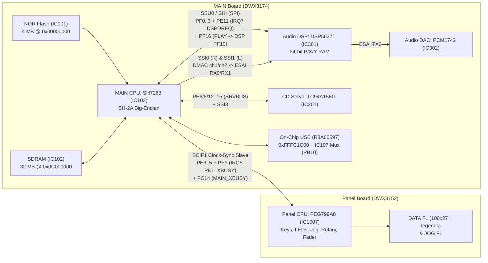

# CDJ-850 Reverse Engineering & Modding Reference

This document summarizes the reverse-engineered architecture, memory map, firmware container rules, inter-processor protocols, and key symbols of the Pioneer CDJ-850 (`C850MAIN.UPD` v1.13). It is designed as a developer reference for writing and validating new firmware mods for the CDJ-850.

> [!NOTE]
> All firmware addresses below refer to **CDJ-850 MAIN v1.13** (`C850MAIN.UPD`, SHA-256 `12ed34539d844e4c3d9230eebccbc31f0b6ff2ac4d813455084987c53beac3b7`). For hardware schematics, pinouts, service modes, and error codes, see [docs/cdj850-service-manual.md](cdj850-service-manual.md).

---

## 1. System Architecture & Memory Map

Unlike the SH-4A players (CDJ-2000, CDJ-2000NXS, CDJ-2000NXS2), the CDJ-850 uses a big-endian **Renesas SH7263 (SH-2A)** MAIN CPU (`IC103`, 200 MHz core / 66 MHz bus) paired with a **Motorola/Freescale DSP56371** 24-bit audio DSP (`IC301`) and a **Panel CPU** (`IC1007`, `PEG799A8`) driving both VFD displays (`DATA FL` and `JOG FL`).



### SH7263 Address Space

| Address Range | Size | Region | Description |
|---|---|---|---|
| `0x00000000–0x003FFFFF` | 4 MB | CS0 NOR Flash (`IC101`) | Bootloader (`0x000000`), recovery (`0x020000`), packed MAIN (`0x060000`), user settings (`0x3F8000`). Uncached alias at `0x20000000`. |
| `0x0C000000–0x0DFFFFFF` | 32 MB | CS3 SDRAM (`IC102`) | Unpacked MAIN firmware (`0x0C000000–0x0C38FFE0`), BSS/heap/buffers (`0x0C1C14DC+`), bootloader staging (`0x0DDEFA20`). |
| `0xFFF80000–0xFFFBFFFF` | 256 KB | On-Chip RAM | Reset stack (`0xFFF90000`), RTOS pool-2 kernel objects (`0xFFF86638+`), fast ISRs (`0xFFF8DC00+`). |
| `0xFFFC1000` | 4 B | CCR | Cache control register. |
| `0xFFFC1C00–0xFFFC1CFF` | 256 B | USB (`R8A66597`) | On-chip full-speed USB host (USB-A) and function (USB-B) controller (SH7263 register offsets). |
| `0xFFFE0800–0xFFFE0FFF` | 2 KB | INTC | Interrupt controller (`ICR0/1/2`, `IRQRR`, `IPR01..IPR17`). |
| `0xFFFE1000–0xFFFE13FF` | 1 KB | DMAC | 8-channel DMA controller (`ch1` = SSI0 TX, `ch2` = SSI1 TX, `ch7` = USB_DMA0). |
| `0xFFFE3800–0xFFFE3FFF` | 2 KB | Ports / PFC | GPIO data (`PxDRL/H`), pin state (`PxPRL/H`), direction (`PxIORL/H`), pin function (`PxCRL/H`). |
| `0xFFFE7000–0xFFFE701F` | 32 B | SSU0 | Synchronous Serial Unit 0 — master SPI link to DSP56371 SHI (`PF3` = `DSPCS`, `PF7` = `DACCS`). |
| `0xFFFE8000` / `0xFFFE8800` | 64 B | SCIF0 / SCIF1 | `SCIF0`: ASCII debug UART (`115200 8N1`). `SCIF1`: clock-synchronous slave link to Panel CPU. |
| `0xFFFEC000–0xFFFEC00F` | 16 B | CMT | Compare Match Timer `ch0` (1 ms RTOS system tick, vector `142`, level `8`). |
| `0xFFFFC000` / `0xFFFFC800` | 32 B | SSI0 / SSI1 | Serial Sound Interfaces 0 (right) and 1 (left) feeding PCM blocks to DSP56371 ESAI. |

### SH-2A Architectural Quirks for Mod Authors
1. **Big-Endian Only**: Instructions and literal pools are big-endian (`sh4-linux-gnu-as --isa=sh4 -big`).
2. **32-Bit SH-2A Instructions**: The firmware uses SH-2A 32-bit instructions extensively:
   - `movi20 #imm20, Rn` (`0000nnnniiii0000` + 16-bit low word) and `movi20s #imm20, Rn` (`<< 8`).
   - 32-bit `mov.b/w/l` and `movu.b/w` with 12-bit displacements (`0011nnnnmmmm0001` + subword).
   - 32-bit bit operations (`bset.b`, `bclr.b`, `bld.b`, `bst.b` on `0011nnnn0iii1001`).
   - 16-bit SH-2A instructions: `rts/n` (`0x006B`, return without delay slot), `jsr/n @Rn` (`0x4n4B`, call without delay slot), `nott` (`0x0068`, invert `SR.T`).
3. **No `SR.RB` / `SR.BL` / `SR.MD` Bits**: Unlike SH-4, SH-2A has no general-register bank bit (`RB`) in `SR` and no MMU. All code runs flat in physical memory (`0x0Cxxxxxx` cached SDRAM, `0x2Cxxxxxx` uncached SDRAM alias).

---

## 2. Firmware Container (`C850MAIN.UPD`), Flash Layout & Bootloader

`C850MAIN.UPD` (2,156,300 bytes in v1.13) is a flat binary image with **no section manifest and no Motorola S-records**.

### Container & 4 MB NOR Flash Map

| Flash / File Offset | Size | Region | Contents |
|---|---|---|---|
| `0x000000–0x01FFFF` | 128 KB | Stage-1 & Stage-2 Bootloader | Reset vectors (`PC = 0x00000100`, `SP = 0xFFF90000`); stage-2 unpacker at `0x010000` (copied to SDRAM `0x0DDEFA20` at reset). |
| `0x020000–0x03FFFF` | 128 KB | Recovery Image | Standalone packed recovery firmware (`BE32` length `0x01EC37` at `0x020000`, stream, `BE16` sum16 `0x7079`). Booted if MAIN fails checksum. |
| `0x040000–0x05FFFF` | 128 KB | Erased Gap | `0xFF` bytes. |
| `0x060000–0x06001F` | 32 B | MAIN Label | `"CDJ-850 MAIN\0\0\0\0"` (`0x060000..0x06000F`) + `"1.13\0..."` (`0x060010..0x06001F`). |
| `0x060020–0x060023` | 4 B | Packed Length | `BE32` LZSS stream byte count (`0x0019E6E6` = 1,697,510 bytes in stock v1.13). |
| `0x060024–0x1FE709` | `len` | Packed MAIN Stream | Okumura LZSS stream (ring size `4096`, pre-filled with `0x20`, initial write cursor `4078`). |
| `0x1FE70A–0x1FE70B` | 2 B | Bootloader Checksum | `BE16` 16-bit plain byte sum (`sum(bytes) & 0xFFFF`) over `0x060020 .. 0x060024 + len` (length word + stream; `0xFB71` in stock v1.13). |
| `0x1FE70C–0x20E70B` | 64 KB | File Tail Padding | `0x10000` zero bytes in `.UPD` file (`0xFF` in flash past the programmed sectors). |
| `0x200000–0x3EFFFF` | 1.93 MB | Unused Flash Window | Erased (`0xFF`). The MAIN updater erases/programs up to `0x3EFFFF` (57 × 64 KB sectors from `0x060000`). |
| `0x3F0000–0x3FFFFF` | 64 KB | Persistent Settings | Never touched by firmware updates. User UTILITY settings & key states live at `0x3F8000` (`PERSIST=1` preserves this sector). |

### Bootloader Verification & Unpack (`boot.bin`)
1. At power-on reset (`0x00000100`), stage 1 initializes BSC/SDRAM, copies stage 2 (`0x010000`) to `0x0DDEFA20`, and jumps to it.
2. Stage 2 (`0x010160`) reads `len = BE32 @ 0x060020` and `want = BE16 @ (0x060024 + len)`.
3. It sums every byte in `0x060020 .. 0x060024 + len` (`0x0100B2`).
4. If `(sum & 0xFFFF) == want`, it LZSS-decodes exactly `len` bytes into SDRAM at `0x0C000000–0x0C38FFE0` (3,735,520 bytes) and executes `jsr @0x0C000000`.
5. If the checksum mismatches, it runs the same check and unpack on the recovery image at `0x020000`.

### Service-Mode USB Updater (`0x0C08EC44`)
- Holding **USB SELECT + RELOOP** at power-on enters USB update mode in MAIN.
- `0x0C08F3C2` reads `C:/C850MAIN.UPD` into a 4 MB buffer at `0x0C1E8E5C` (pre-filled with `0xFF`) and dispatches `FlashTask` (`0x0C08E92C` → `0x0C08EC44`) in **mode 6**:
  - Mode 6 erases and programs 57 × 64 KB sectors (`0x060000–0x3EFFFF`), leaving the bootloader (`0x000000–0x05FFFF`) and settings (`0x3F0000–0x3FFFFF`) untouched.
  - **Version skip rule**: `0x0C08EC44` compares the version string at offset `0x060010` (`D.DD`) against the running firmware's version. **If they are equal, it skips flashing and immediately reports `COMPLETE!`.** When repacking an update for USB installation via `scripts/firmware/c850_repack.py`, pass `--version 1.14` (or another bumped `D.DD`) if installing over stock `1.13` via service mode.
  - After each sector erase (`0x0C08E842`) and word program (`0x0C08E8AE`), the updater polls **flash `RY/BY#` on Port C pin `PC2`** (`0xFFFE391E` bit 2 == 1).

---

## 3. RTOS & Task Table

MAIN runs a TOPPERS/µITRON-style real-time kernel. Tasks are registered from static 20-byte descriptors (`entry, priority, stack_size, stack_ptr, name_ptr`).

### Core RTOS Primitives
| Address | Name / Role | Notes |
|---|---|---|
| `0x0C0CDDCA` | Kernel object initializer | Allocates from Pool 1 (SDRAM `0x0CEEFA20`) and Pool 2 (on-chip RAM `0xFFF86638`, head pointer `0x0CE4A330`). |
| `0x0C0CB640` | `prcv_mbx` | Receive from mailbox (used by audio task on mailbox 2). |
| `0x0C0D7464` | `audio_send_cmd(cmd, flag, ...)` | Formats a command packet and sends it to the audio task via `snd_mbx(2)`. |
| `0x0C08EFE0` | Settings getter | Reads user settings loaded from flash into RAM at `0x0C9DA23C`. |
| `0x0C08F294` | Factory defaults loader | Initializes default settings (including VINYL mode bit 7 of `0x0C9DA23C`). |

### Boot-Critical Task Roots (`mods/bootcrit.py`)
`mods/validate.py` walks the call graph from the hardware vectors (`0x100, 0x400, 0x600, 0x800`) and the following CDJ-850 task descriptors to guarantee that no mod overwrites code needed to boot, talk to the panel/display, mount USB, or run a recovery firmware update:
- `initTask`
- `idleTASK`
- `FlashTask` (`0x0C08E92C`)
- `serialTask`
- `usbTask` (`0x0C10B34A`)
- `DjControlTask` (`0x0C014E14`)
- `DisplayTask` (`0x0C061454`)

---

## 4. MAIN Key Functions & Global State Map

### Player, Transport & Pitch (`DjControlTask`)

| Address | Symbol / Type | Description |
|---|---|---|
| `0x0CE6D25A` | `u8 is_usb_or_data_mode` | `1` in USB/data mode (set by `FUN_0C0EEFB0`), `0` in CD mode. Mirrors `0x0CE6D25B`. |
| `0x0CE6D252` | `u8 active_source_index` | Source index (`2` = USB). |
| `0x0CE6D25F` | `u8 player_state` | `0x0C0E6D25D + source_idx`: `0x0A` = USB browse, `2` = loading, `3` = playing, `4` = paused (CDJ mode / CUE), `5` = paused/braking (VINYL mode), `6` = cued. |
| `0x0CE6CA9D` | `u8 speed_substate` | `0` = normal pitch-tracked, `1` = VINYL scratch, `2`/`0x12` = instant start with `HOLD=1`, `3` = hold/cued, `4`/`0x24` = VINYL touch/brake/release ramp. |
| `0x0CE6D0DD` | `u8 time_mode_remain` | `1` = `REMAIN`, `0` = elapsed `TIME` (toggled by `0x0C0D9194`). |
| `0x0CE6D0DE` | `u8 jog_mode_vinyl` | `1` = `VINYL` (factory default), `0` = `CDJ` mode. |
| `0x0CE6D0DF` | `u8 auto_cue_enabled` | `1` = `A.CUE` on, `0` = off (toggled by holding TIME MODE at `0x0C0D91E4`). |
| `0x0CE6D0E0` | `u8 master_tempo_enabled` | `1` = `MASTER TEMPO` on, `0` = off (toggled by `0x0C0D8D78`; sets bit 22 `0x400000` on DSP speed word). |
| `0x0CE6D0E1` | `u8 tempo_range` | `1` = ±6%, `2` = ±10% (default), `3` = ±16%, `4` = `WIDE` (±100%). Cycled by `0x0C0D8DC0`. |
| `0x0CE6D0F1` | `u8 play_intent_latch` | Set to `1` when PLAY is pressed during load or in VINYL brake mode. |
| `0x0CE6D0F2` | `u8 vinyl_brake_flag` | `1` = ramping speed down to `0` (brake/touch), `0` = ramping speed up to target pitch. |
| `0x0CE6D0F3` | `u8 jog_touched` | `1` while the platter top is touched (`0x0C0ED0B4` / `0x0C0ED10C`). |
| `0x0CE6D0F5` | `u8 pitch_force_refresh` | Set to `1` by MT/Tempo Range buttons (`0x0C0D8E4E`) to force a pitch/HOLD update even when fader ADC is unchanged. |
| `0x0CE6D0FD` | `u8 nav_view_selector` | `0` = `INFO` (default loaded view), `1` = `BROWSE`, `3` = `TAG LIST`. |
| `0x0CE6CA48` | `u16 pitch_fader_raw` | Incoming SCIF1 fader sample (center = `0x8000`, written at `0x0C0ECF12`). |
| `0x0CE6CA4A` | `u16 pitch_fader_center` | Incoming SCIF1 fader center reference (`0x8000`, written at `0x0C0ECF1A`). |
| `0x0CE6C930` / `32` | `u16 pitch_prev` / `pitch_cur` | Filtered pitch values compared by `FUN_0C0D59B8` to detect fader movement. |
| `0x0CE6C938` | `u16 dsp_shi_word0_flags` | Bit 15 (`0x8000`) = `HOLD` (tell DSP to apply speed immediately without ramping). |
| `0x0CE6C940` | `u32 dsp_target_speed` | 24-bit fixed-point playback speed sent to DSP (`0x080000` = `1.0x`, `0x100000` = `2.0x`, bit 22 `0x400000` = Master Tempo / Reverse flag depending on word). |

### Key Transport & Audio Functions
- **`FUN_0C0D59B8` (`0x0C0D59B8`)**: Master speed & `HOLD` calculator called on every player tick.
  - Computes target speed in `0x0CE6C940` from the tempo fader, range (`0x0CE6D0E1`), jog bend, or VINYL start/brake curves (`FUN_0C0D5FBA` / `FUN_0C0D5FEC`).
  - **USB WIDE math note**: Two branches in `FUN_0C0D59B8` check `*0x0CE6D25A != 1` before selecting the overflow-safe `WIDE` multiplier (`0x51EB851F`), because stock firmware only allows `WIDE` on CD (`*0x0CE6D25A == 0`). Enabling `WIDE` on USB requires patching those two conditional branches (`tempowidemath1` and `tempowidemath2` in `mods/tempo_wide/cdj850/patch.py`).
- **`FUN_0C0D8D78` (`0x0C0D8D78`)**: Handler for `TEMPO` (range cycle at `0x0C0D8DC0..0x0C0D8DDE`) and `MASTER TEMPO` (`0x0C0D8E4E`).
- **`FUN_0C0DEB50` (`0x0C0DEB50`)**: `PLAY/PAUSE` button handler. Note that **the CDJ-850 automatically starts playing a track as soon as load completes** (`0x0C0EAE2A..0x0C0EAE7A` transitions to state `3` and sends audio command `(1, 1)` once 75 sectors are buffered); pressing PLAY on an auto-playing track therefore transitions `3 -> 5` (pause/brake).
- **`FUN_0C0DC996` (`0x0C0DC996`)**: `CUE` button handler.
- **`FUN_0C0DD978` (`0x0C0DD978`)**: Main player tick and jog pitch-bend / scratch velocity processor.
- **`FUN_0C015BD4` / `FUN_0C015B18`**: Builds / clears a 4-segment audio loop (`0x0C1C1460` / `0x0C7F6674`).

### Audio Ring Buffer & SSI Feeder
- **PCM Sector Ring (`0x0C1E8E5C–0x0C74B05C`)**: Holds `2400` (`0x960`) entries of `0x930` bytes each (2,352 bytes = 1 CD-DA sector = 588 stereo 16-bit big-endian frames). Both CD and USB WAV/MP3/AAC decoders write into this ring.
  - `0x0C7F645C`: Current play sector index (`READ_INDEX`, 16-bit halfword; `0x0C7F6466` in state 4).
  - `0x0C7F645E`: Current write sector index (`WRITE_INDEX`, 16-bit halfword).
  - `0x0C7F6470` / `0x0C7F6474`: Byte read / write pointers (`base + idx * 0x930`, set by `FUN_0C005C44`).
- **Stream Start / Stop**:
  - `FUN_0C005B14` ("start DSP stream"): Clears stale `IRQ7` flag (`0xFFFE0806` bit 7), unmasks `IRQ7` priority to `7` (`IPR02` low nibble at `0xFFFE081A`), and drives **Port F pin `PF16` (`PLAY`) high** (`PFDRH |= 1`).
  - `FUN_0C005BB6` ("stop DSP stream"): Drives `PF16` low (`PFDRH &= ~1`).
- **IRQ7 (`DSPDREQ`) Feeder (`0x0C076624`, vector `71`)**:
  - Triggered whenever the DSP pulls `PE11/IRQ7` (`DSPDREQ`) low.
  - Masks `IRQ7` (`IPR02` low nibble = `0` at `0x0C076640`), calls `FUN_0C076474` to split the next 84 stereo frames into 45 32-bit words per SSI channel (`[0, header, 42 packed sample pairs, 0]`, where `SSI0` right header = `0xCE5C0000` and `SSI1` left header = `0xCA5A0000`), and starts DMAC `ch1` (`SSI0_TX`, `DMARS0 = 0x2300`) and `ch2` (`SSI1_TX`, `DMARS1 = 0x0027`).
  - When DMAC `ch2` finishes (`DEI2` ISR `0x0C076444`, vector `116`), it re-enables `IRQ7` (`IPR02` low nibble = `7`) so the DSP can request the next block.

---

## 5. SCIF1 Panel Protocol (MAIN ↔ Panel CPU `IC1007`)

MAIN communicates with the front-panel microcontroller (`IC1007`) over **SCIF1 (`0xFFFE8800`)** configured as a clock-synchronous slave (`PE3/SCK1 = TSCK`, `PE5/TXD1 = TSO`, `PE4/RXD1 = TSI`).
- Handshake lines: `PC14 = MAIN_XBUSY` (asserted by MAIN at the end of `0x0C0F9F14` setup) and `PE9/IRQ5 = PNL_XBUSY` (driven high by the Panel CPU to frame each transaction).
- Rising edge on `PNL_XBUSY` triggers MAIN's `IRQ5` ISR (`0x0C0FA05E`, vector `69`), which preloads 16 TX bytes with `TIE=1`. Subsequent 16-byte frames in the same `PNL_XBUSY` window are clocked via `TXI1` (`0x0C0FA13C`, vector `199`) until MAIN clears `TIE`.
- **Checksum (`0x0C0F9EE8`)**: 8-bit end-around-carry sum (`sum8ec`):
  ```c
  uint8_t sum8ec(const uint8_t *p, unsigned n) {
      unsigned sum = 0;
      for (unsigned i = 0; i < n; i++) {
          sum += p[i];
          sum = (sum & 0xff) + (sum >> 8);
      }
      return sum;
  }
  ```

### Panel → MAIN Input Frames (RX)

Each transaction sends two 16-byte input frames from the Panel CPU to MAIN (followed by zero-padded frames if MAIN continues streaming display chunks):

#### RX Frame 1 (Type `0x01`, checksum at byte `15` over bytes `0..14`)
| Bytes | Field | Description |
|---|---|---|
| `0` | `0x01` | Frame type 1 identifier. |
| `1..2` | `0x01, 0x00` | Panel firmware version (`1.00`, displayed by MAIN as `Panel : 1.00`). |
| `3..4` | `u16 BE rotary` | Signed/wrapping 16-bit rotary browse encoder counter. |
| `5..6` | `u16 BE pitch` | Tempo fader ADC sample (`0x8000` = center; `0x0000` = full `+`, `0xFFFF` = full `-`). |
| `7..8` | `u16 BE pitch_center` | Tempo fader center reference (`0x8000`, read at `0x0C0ECF12`). |
| `9..10` | `u16 BE jog_pos` | Rolling 16-bit jog position counter. |
| `11..12` | `u16 BE jog_period` | Jog pulse period (`556` = 100% nominal platter speed (`0xD904 / 556`), `278` = 200%, `0` = stopped). |
| `13..14` | `u16 BE btn_word0` | `0x0100` = Rotary Push (`ENTER`), `0x2000` = `JOG_TOUCH`, `0x4000` = `JOG_FWD`, `0x8000` = `JOG_MOVE`. |
| `15` | `sum8ec(0..14)` | End-around-carry checksum. |

#### RX Frame 2 (Type `0x02`, checksum at byte `12` over bytes `0..11`)
Unpacked by MAIN `0x0C0D610C` against the button tables at `0x0C194EA4` / `0x0C194FD8`:

| Bytes | Word | Bit Masks (`u16 BE` per pair, or single byte) |
|---|---|---|
| `0` | — | `0x02` (Frame type 2 identifier). |
| `1..2` | Word 1 | `0x0100` = `USB STOP`, `0x0200` = `PLAY/PAUSE`, `0x0400` = `CUE`, `0x0800` = `LOOP IN`, `0x1000` = `LOOP OUT`, `0x2000` = `RELOOP/EXIT`, `0x0001` = `BEAT 1`, `0x0002` = `BEAT 2`, `0x0004` = `BEAT 4`, `0x0008` = `BEAT 8`, `0x0010` = `BEAT SELECT`, `0x0020` = `REV`. |
| `3..4` | Word 2 | `0x0100` = `EJECT`, `0x0200` = `VINYL` (Jog Mode), `0x0800` = `TEMPO` (Range), `0x1000` = `MASTER TEMPO`, `0x0001` = `CALL <`, `0x0002` = `CALL >`, `0x0004` = `DELETE`, `0x0008` = `MEMORY`. |
| `5..6` | Word 3 | `0x0100` = `TIME MODE / AUTO CUE`, `0x0200` = `TRACK SEARCH |<<`, `0x0400` = `TRACK SEARCH >>|`, `0x0800` = `SEARCH <<`, `0x1000` = `SEARCH >>`, `0x0001` = `PC` (`LINK`), `0x0002` = `USB`, `0x0004` = `DISC` (`CD`). |
| `7..8` | Word 4 / Pot | Byte 7 (`hi`): `0x01` = `BROWSE`, `0x02` = `TAG LIST`, `0x04` = `INFO`, `0x08` = `MENU` (`UTILITY`), `0x10` = `BACK`, `0x20` = `TAG TRACK`. Byte 8 (`lo`): `VINYL SPEED ADJUST` pot (`0..255`). |
| `9..11` | — | Zero (`0x00`). |
| `12` | `sum8ec(0..11)` | End-around-carry checksum. |
| `13..15` | — | Zero (`0x00`). |

### MAIN → Panel Output Frames (TX)

MAIN's `DisplayTask` (`0x0C061454`) and panel TX builders (`0x0C065D9E..0x0C06664E`) send four families of 16-byte frames (all checksummed at byte `15` via `sum8ec(0..14)`):

1. **Status Page `0x01` (first frame of a window, built at `0x0C065D9E`)**:
   - Byte `1`: Jog CUE marker position (`1..85` segments, `0` = off; built at `0x0C0EC224`).
   - Byte `2`: Jog flags (`0x08` = `VINYL` lamp, `0x20` = `JOG TOUCH` lamp, `0x40` = audio memory blink; built at `0x0C064D10`).
   - Byte `3`: Jog playhead marker (`1..135` segments around the ring, `0`/`0x88` = blank; built at `0x0C0EC350`).
   - Byte `4`: Binary track number (`0..99`, `0xBB` = overflow, `0xFF` = blank; from `0x0C9D0ADB`).
   - Bytes `5, 6, 7`: Binary `Minutes`, `Seconds`, `Frames` (`0..74` frames/sec; from `0x0C9D0ADC..0x0C9D0ADE`).
   - Bytes `8..9`: `u16 BE` whole-number BPM (`1..999`, `0xFFFF` = blank; from `0x0C9D0AE0`).
   - Bytes `10..11`: `u16 BE` unsigned pitch magnitude in hundredths of a percent (or tenths in `WIDE`; paired with Page `0x02` sign/range flags).

2. **Status Page `0x02` (first frame of alternating windows, built at `0x0C065DF8`)**:
   - Byte `4`: Playing-address elapsed column count (`0..100`, built at `0x0C0637CC`).
   - Byte `5`: Panel button LEDs A (`0x02` = USB activity indicator, `0x04` = `PC`, `0x08` = `CUE`, `0x10` = `PLAY`, `0x20` = `LOOP IN`, `0x40` = `LOOP OUT`, `0x80` = `USB`).
   - Byte `6`: Panel button LEDs B (`0x01` = `RELOOP`, `0x02` = `DISC`, `0x08` = `REV`, `0x10` = `MASTER TEMPO` button LED, `0x20` = `VINYL`, `0x40` = `EJECT`).
   - Byte `7`: Beat Loop & Navigation LEDs (`0x01..0x08` = `BEAT 1/2/4/8`, `0x10` = `BROWSE`, `0x20` = `TAG LIST`, `0x40` = `INFO`, `0x80` = `MENU/UTILITY`; built at `0x0C063444..0x0C063480`).
   - Byte `8`: Power/Standby status (`0x01` = auto-standby requested).
   - Byte `9`: Playing-address end-of-track flash flags (`bit 0` = fast warning <15s, `bit 1` = slow warning <30s, `bit 2` = lit phase).
   - Byte `10`: Active CUE / Loop-In column on the bottom blue strip (`1..100`, `0` = dark; built at `0x0C0642CC`).
   - Byte `11`: Pitch sign & VFD lamps (`bits 1:0`: `0` = zero, `2` = minus, `3` = plus; `bit 4` `0x10` = VFD `MEMORY` legend; `bit 7` `0x80` = VFD red `MT` legend).
   - Byte `12`: VFD `A.CUE` & pitch decimals (`bit 0` `0x01` = VFD `A.CUE` legend; `bits 5:4`: `0x10` = hundredths, `0x20` = tenths).
   - Byte `13`: Time mode (`bit 0` `0x01` = `REMAIN`, `0` = elapsed).
   - Byte `14`: Pitch range flags (`bit 1` `0x02` = enable range badge; `0x80` = ±6, `0x40` = ±10, `0x20` = ±16, `0x04` = `WIDE`).

3. **Display Text Burst (`0x80` header + `0x81..0xAE` 14-byte chunks, built at `0x0C066046` / `0x0C0660D4`)**:
   - `0x80` frame: Byte `1` = sequence counter, Byte `2` = display mode (`0x01` = 3-row browser, `0x07` = dialog, `0x08` = single centered message such as `NO DISC` / empty list, `0x0A` = loaded track).
   - `0x81..0xAE` frames: Concatenated 14-byte slices (bytes `1..14` of each frame) holding 3 sequential row records:
     - Each row record is `[tag, attr0, attr1, attr2, len, text[0..len-1]]`.
     - `(tag & 0x03)` is row index `1..3`. `tag & 0x20` (bit 5) marks the highlighted/inverted browser row (e.g. `0x25/0x02/0x03` selects row 1; `0x01/0x26/0x03` selects row 2).
     - In loaded mode (`0x0A`), row 1 is the inverted track title, and row 2 with `attr0 == 0x07` carries the artist name.

4. **Auxiliary Overview & Memory Cue Frames (`0x60` and `0x70..0x77`)**:
   - `0x60` (`0x0C06664E` / `0x0C0664A8`): Bytes `2..14` hold a 100-bit MSB-first bitmap of saved memory-cue and loop columns (`0..99`) for the top red strip.
   - `0x70..0x77` (`0x0C0662AE`): 100 waveform overview columns (`0..15` height, mapped to `0..5` dot rows) from `0x0C9D1199` (12 samples at `0x70[3..14]`, 14 samples each at `0x71..0x76[1..14]`, 4 samples at `0x77[1..4]`).

---

## 6. Audio DSP (`DSP56371`) Boot, SHI Command & ESAI Pipeline

### 4-Stage SHI Bootstrap in MAIN (`0x0C155B28–0x0C1593A1`)
The DSP56371 (`IC301`) is hardware-strapped to **Mode 5** (`MODD:C:B:A = 0:1:0:1`, SHI slave SPI bootstrap). At boot, MAIN uploads `0x3879` (14,457) bytes from `0x0C155B28` over `SSU0` (`PF3/SCS0 = DSPCS` low).
Each stage begins with a 3-byte big-endian word count and a 3-byte big-endian P-RAM load address, followed by `count` 24-bit big-endian words:

| Stage | MAIN Offset | Word Count | DSP Load Addr | Role |
|---|---|---|---|---|
| Segment 1 | `0x0C155B28` | `9` (`0x0009`) | `P:$000000` | Initial PLL/clock setup; ends with `JMP $FF0000` (`0x0AF080, 0xFF0000`) to re-enter the DSP bootstrap ROM. |
| Segment 2 | `0x0C155B49` | `82` (`0x0052`) | `P:$000000` | Secondary setup; ends with `JMP $FF0000`. |
| Segment 3 | `0x0C155C45` | `896` (`0x0380`) | `P:$000000` | Initializes X/Y data tables and ring descriptors (`P:0x000..0x05D`); ends with `JMP $FF0000`. |
| Segment 4 | `0x0C1566CD` | `3824` (`0x0EF0`) | `P:$000000` | Main DSP audio application (`P:$0000..P:$0EEF`). `P:$0000` jumps to `P:$0102`; `P:$0080..P:$00FE` is **zeroed unused vector space** (126 words / 378 bytes) available for DSP mods. |

After each segment, MAIN checks `PE11/IRQ7` (`DSPDREQ`) against the expected levels in `0x0C1C1AE8` (`0, 1, 0, 1`).

### Runtime 6-Byte SHI Command & Reply (`FUN_0C005D54` ↔ DSP `P:0x11E..0x156`)
Every few milliseconds, MAIN's `0x0C077570` exchanges a 6-byte full-duplex frame (two 24-bit words) with the DSP over `SSU0`:
- **MAIN → DSP TX (`0x0C7F671B`)**:
  - **Word 0** (`bytes 0..2`, `bit 23 == 1` always):
    - `byte 0`: `0x80` (sync) | `0x40` (audio mode 0/2) | `0x20` (if `0x0C7F672A` != 0) | mode/track flags (`0xE2` during active playback, `0xC2` idle).
    - `bytes 1..2`: `u16` from `0x0CE6C938` (`bit 15` `0x8000` = `HOLD`; `bit 10` `0x0400` = Reverse direction; `bits 11,9,8` = mode bits).
  - **Word 1** (`bytes 3..5`, `bit 23 == 0` always):
    - 24-bit playback speed from `0x0CE6C940` (`0x080000` = `1.0x`, `0x100000` = `2.0x` / +100% WIDE; `bit 22` `0x400000` = Master Tempo time-stretch active).
- **DSP → MAIN RX (`0x0C7F6721`, built at DSP `P:0xC44..0xCBA`)**:
  - **Word 1** (`bytes 3..5`): `0xC00000 | current_dsp_speed` (with `0x200000` set if reverse). MAIN copies this to `0x0C0D5C18` to track the DSP's actual ramped platter velocity.

### DSP Internal Memory & Ring Map (Segment 4)
- `X:<0x1E>`: Target speed received from SHI Word 1.
- `X:<0x1F>` (`:X:<0x20>`): Active instantaneous speed (written immediately when `HOLD=1` at `P:0x1E2`, or ramped toward `X:<0x1E>` by `FUN_P_000731` at `P:0x736..0x760`).
- `Y:$FFFFF5` bit 10 (`PF10`): Driven by MAIN `PF16` (`PLAY`). `PF10 == 1` enables `P:0x1FC` (`DSPDREQ` block requests).
- **Three-ring pipeline**:
  1. **ESAI RX Ring (`Y:0x15000..0x157FF`, size `0x800`)**: Filled by ESAI RX ISR `P:0x3BB..0x43D` (`X:<0x02>` write idx) upon matching `0xCE5C00` (RX0 right) and `0xCA5A00` (RX1 left) block headers and stepping an 84-state LFSR (`Y:$71`, taps `0xCE5C00`, end state `0x413F5B`); drained by `FUN_P_0002B9` (`X:<0x01>` read idx).
  2. **Main Sample Ring (`X:0x10000..0x11FFF`, size `0x2000`)**: Filled by `FUN_P_0002B9` (`X:<0x03>`), consumed/interpolated/time-stretched by `FUN_P_000731` (`X:<0x04>`, stride `2 * ((|X:<0x1F>| * 16 + X:<0x21>) >> 24)`).
  3. **ESAI TX Ring (`Y:0x0E80..0x0EBF`, size `0x40`)**: Filled by `FUN_P_000731` (`X:<0x06>`), shifted out at 44.1 kHz stereo (88.2 kHz slots) by ESAI TX ISR `P:0x43E..0x454` (`X:<0x00>`).

---

## 7. USB-A Host & USB-B PC Mode (MIDI + HID)

Both USB ports share the SH7263's on-chip controller at `0xFFFC1C00` through the `IC107` analog switch (`PB10 = USB_ABSEL`: `1` = USB-A host stick, `0` = USB-B PC device; `PB11 = USB_VBUSON`; `PE10/IRQ6 = USB_CDETFLG`, high = normal).
- **SH7263 USB Register Offsets (`hw/cdj/boards/cdj850/xc/usb.c`)**: Differ from the SH7724 layout! Key offsets: `SYSCFG +0x00`, `SYSSTS +0x02`, `DVSTCTR +0x04`, `CFIFO +0x10`, `D0FIFO +0x14`, `D1FIFO +0x18`, `CFIFOSEL +0x1E`, `D0FIFOSEL +0x24`, `D0FIFOTRN +0x2A`, `INTENB0 +0x30`, `INTSTS0 +0x40`, `PIPESEL +0x64`, `PIPECFG +0x66`, `PIPEMAXP +0x6C` (`DEVSEL` in bits `15:14`). Interrupts: `USBI` vector `140` (`IPR08[15:12]`), `DEI7` vector `136` (DMAC `ch7`, `DMARS3 = USB_DMA0`).
- **USB-B PC Mode**: Pressing `PC` switches `PB10` low and enumerates as Pioneer `CDJ-850` (`VID = 0x08E4`, `PID = 0x0157`):
  - **USB-MIDI**: Bulk IN endpoint `0x83`.
  - **USB-HID**: Interrupt IN endpoint `0x87` (20-byte reports), Interrupt OUT endpoint `0x06` (36-byte reports), 65-byte HID report descriptor.

---

## 8. Writing & Validating CDJ-850 Mods

The mod framework (`mods/`) supports three patch types on the CDJ-850 (`mods/players/cdj850.py`):

### 1. Code Cave in MAIN (`MAIN_PROFILE`)
Because the unpacked MAIN image (`0x0C000000–0x0C38FFE0`) contains almost no contiguous `0xFF` erased flash and its tail (`0x0C1E8E5C+`) overlaps runtime buffers, CDJ-850 MAIN code hooks are placed in a **1,118-byte code cave** formed by six unreached RTOS debug-shell print handlers (`"show semaphore info"` through `"show message buffer info"`, SHA-256 `891c18aac15fe3179e6b6f72df866a24c9bdb443359cfdd63fe2465e0ee6bba8`).
- `sigpatch.py` locates this cave by its string references, verifies its stock SHA-256, and places hook trampolines and mod routines inside it.
- **Hook contract (`sigpatch.Mod(hook=True)`)**:
  - `sig` is a list of big-endian 16-bit instruction words (`0xDxxx` PC-relative loads match on opcode + register regardless of displacement).
  - `sig[start:end]` must be at least 12 bytes (6 halfwords) to hold the jump to the trampoline (`mov.l target, r1; jmp @r1; nop; .long target`). If replacing a 32-bit SH-2A instruction (such as `movu.b @(0,r5), r6` = `0x3651, 0x8000`), keep both 16-bit halves inside `sig[start:end]`.
  - The trampoline executes the relocated original `sig[start:end]` span first (rewriting any `mov.l @(disp,pc)` loads to its own literal pool), pushes `r0..r7` onto the stack (`r15`), and calls your routine with:
    - `r4` = pointer to saved `r0..r7` on the stack (`@(0,r4)` = `r0`, `@(4,r4)` = `r1`, ..., `@(24,r4)` = `r6`, `@(28,r4)` = `r7`). Modifying `@(4*n, r4)` changes the register value seen when the trampoline returns to the firmware!
    - `r5` = `r15` as the relocated span left it.

### 2. In-Place Data / Branch Edits in MAIN (`sigpatch.DataPatch`)
For changing constants, tables, or conditional branches in place without a trampoline:
- Identify a unique byte sequence (`table`) near the edit target that is not itself modified.
- Specify `before` (bytes before `table` where the search window starts), `reach` (window length), and `edits=(Edit(old_bytes, new_bytes),)`.

### 3. Audio DSP Program Mods (`DSP_PROFILE` / `dsppatch.DspMod`)
- `DSP_PROFILE` locates the 4-stage SHI blob at `0x0C155B28` by its 4-word header (`0x000009, 0x000000, 0x300013, 0x04D03F`).
- `DspMod` can edit 24-bit words in place (`edits=((p_addr, old_24bit, new_24bit), ...)`) and place new 24-bit DSP56300 subroutines into the zeroed vector gap `P:$0080..P:$00FE` of Segment 4 (`code=((0x0080, 'modname'),)`).
- `dsppatch.verify_shi_boot()` automatically verifies that Segments 1–3 still end with `JMP $FF0000` (`0x0AF080, 0xFF0000`), Segment 4's reset vector `P:$0000` is non-zero, and no stock instruction references the claimed `P:$0080..P:$00FE` space.

### Reference Mods Included in the Repository
- **[`mods/tempo_wide/`](../mods/tempo_wide/cdj850/patch.py)**:
  - Hooks `0x0C0D8DC2..0x0C0D8DCE` in the `TEMPO` button handler (`main_tempowide.s`). The handler picks the next range from the source flag `*0x0CE6D25A` (in `r0`) and the current range (`r6`, 1=±6, 2=±10, 3=±16, 4=`WIDE`): on USB (`r0 == 1`) `1->2, 2->3, 3->1, 4->3`, otherwise (CD) `1->2, 2->3, 3->4, 4->1` **[static]**. The routine clears saved `r0` at `@(0,r4)`, so USB uses the CD table and `TEMPO` cycles ±6 → ±10 → ±16 → `WIDE` → ±6. (Before 2026-11-21 it also rewrote `r6` 2 → 3, which skipped ±16.)
  - Applies two `DataPatch` edits (`tempowidemath1`, `tempowidemath2`) in `FUN_0C0D59B8` so USB mode uses the overflow-safe `WIDE` pitch multiplier.
- **[`mods/dsp_probe/`](../mods/dsp_probe/cdj850/patch.py)**:
  - Replaces a main-loop `NOP` (`0x000000`) at Segment 4 `P:$01EA` with `JSR $0080` (`0x0D0080`) and places `nop; nop; rts` (`0x000000, 0x000000, 0x00000C`) at `P:$0080`.

### Developer Workflow Commands

```sh
# 1. List available CDJ-850 mods
python3 mods/patch_update.py --model cdj850 --list

# 2. Re-assemble MAIN (.s -> .bin) if you edited SH-2A assembly
python3 mods/patch_main.py --assemble

# 3. Patch a stock C850MAIN.UPD and run all static + boot-critical checks
python3 mods/patch_update.py --model cdj850 path/to/C850MAIN.UPD C850MAIN_MOD.UPD tempo_wide dsp_probe

# 4. Independently validate any modded C850MAIN.UPD against stock
python3 mods/validate.py --model cdj850 --stock path/to/C850MAIN.UPD C850MAIN_MOD.UPD

# 5. Patch an installed emulator flash image directly for testing
python3 mods/patch_main.py --model cdj850 --flash extract/cdj850/flash_cdj850.bin /tmp/flash_mod.bin tempowide tempowidemath1 tempowidemath2 dspprobe

# 6. Run the CDJ-850 mod test suite (unit + live QEMU -icount boot verification)
python3 -m pytest tests/test_cdj850_mods.py
```
