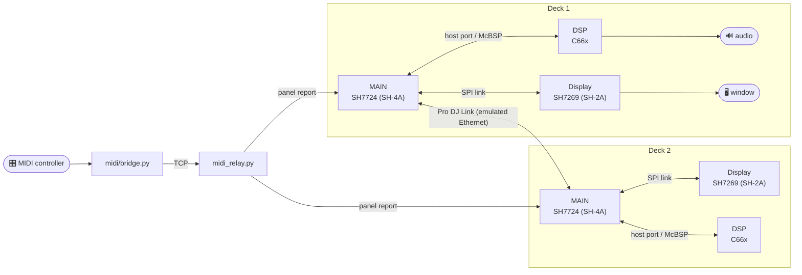

# How it works

A CDJ-2000NXS2 is three computers in one box, and all three run here (the
older players are built the same way, from their own parts):

| chip | job in the player | here |
|---|---|---|
| Renesas SH7724 (SH-4A) | **MAIN**: transport, file system, rekordbox database, Pro DJ Link, the front panel | QEMU's SH-4 with a board model written for this project (`hw/cdj/`) |
| Renesas SH7269 (SH-2A) | the **display processor**: draws the 7-inch screen from what MAIN sends it | a second, big-endian QEMU with its own board model (`hw/cdj/boards/nxs2/sh7269gui.c`) and a window on your desktop |
| TI TMS320C6655 (C66x) | the **DSP**: decodes the track, time-stretches it, produces the audio | a C66x core written for this project (`hw/cdj/c6x/`), running the program MAIN uploads to it at boot |



The CDJ-2000 and CDJ-2000NXS have a board model of their own
(`hw/cdj/boards/cdj2000/`): an SH7763 MAIN, a Blackfin BF531 display
processor, and a DSP behind a host port (a C6727 on the CDJ-2000, a C6747 on
the CDJ-2000NXS). The XDJ-700, XDJ-1000 and CDJ-900NXS share the NXS2's
SH7724 MAIN, which draws their screen itself, with a C6747 DSP
(`hw/cdj/boards/xdj1000/`). The launcher starts each older player in one
window (see [Other players](setup.md#other-players)).

None of the three knows it is emulated. MAIN talks to the display processor
over the same SPI link, to the DSP over the same host port and McBSP audio bus,
and reads its front panel through the same report from the panel
microcontroller as on the real board. The models were written device by
device, from what the firmware actually touches.

**How it was done.** By reverse engineering, under QEMU, one blocked boot at a
time. The firmware update was unpacked (its container, the LZSS packing of the
MAIN and display images, the resource archives), and the boards were modelled
wherever the firmware stopped: interrupt controllers, DMA, I²C, the USB host
controller, the Ethernet MAC, the SPI link between the two processors, the
DSP's boot path and command protocol. The firmware turned out to be its own
best documentation: it logs to an internal ring, it names its tasks, its keys
and its errors, and a trace hook at any firmware address plus a memory watch
said the rest.

**The NXS2's DSP** needed the most work. There is no usable C66x emulator, so this
project has its own: a VLIW core that issues up to eight instructions a cycle,
with the SoC peripherals the program uses. Interpreted, it is far too slow for
real-time audio, so a **JIT** compiles the hot parts of the DSP program to
native code (`hw/cdj/c6x/tools/`); the [DSP module](dsp-module.md) is that
code, built ahead of time. The instruction decode tables come from GNU binutils.

## A platform for modding the firmware

Running the firmware is the first step; changing what a player does is the
next, and this is built for it. The emulator makes the whole machine
observable and every part of it adjustable, without touching a real deck:

| | |
|---|---|
| 🔍 **Watch it think** | `CDJ_FWLOG` prints the firmware's own internal log; `CDJ_FWTRACE=<address>,...` prints the registers each time execution passes an address; `CDJ_MWATCH=<address>` reports which instruction changed a memory word; QEMU's monitor dumps memory and the screen while it runs. |
| ✏️ **Change it while it runs** | `CDJ_MPOKE` holds memory at a value, `CDJ_PPOKE` writes one when a chosen instruction executes, and `CDJ_PCALL2` calls any firmware function from inside a running task. |
| 🕹️ **Drive it from outside** | Every front-panel key, the jog, the pots and the touch screen are one datagram away (`scripts/run/panel_key.py`, `midi/bridge.py`), so input can be scripted, remapped or generated. |
| 🔁 **Replay the DSP** | The DSP core can record its execution and replay it deterministically, so a change to the audio path can be tested against a recording. |

From here, new behaviour is a question of finding the right code and writing
the right change: remapping controls, adding features to the deck, studying the
Pro DJ Link protocol from a player that speaks it natively, or experimenting
with the audio chain. Keep what you derive from the firmware on your own
machine: the update file, and anything built from it, is Pioneer's.

### Booting from the flash

```sh
MAIN_BOOT=flash ./start.sh
```

By default MAIN starts with its firmware already unpacked into memory
(`extract/main_unpacked.bin`), past the point where the player's own
bootloader hands over. With `MAIN_BOOT=flash` it starts the way the real unit
does: from the reset vector, in Pioneer's bootloader. The firmware update's
MAIN section carries that bootloader, an emergency updater and the packed MAIN
image, at the flash addresses the player's own updater writes them to, and
`./setup.sh --firmware` lays them into `extract/flash.bin` the same way. The
bootloader sets up the clocks and memory, checks the image's checksum, unpacks
it and starts it; a damaged image starts the emergency updater instead, as on
the real player. It adds about two seconds to MAIN's start.

A `flash.bin` made by an older setup holds no bootloader; MAIN then refuses to
start and says so. Run `./setup.sh --firmware <C2KNXS2.UPD>` again to rebuild it.

### Starting from a saved deck

Booting a deck and loading a track takes minutes on the older players and
longer on the NXS2; a test or a change to the firmware's later stages should
not pay that every time. A deck can be saved while it runs and started from
that moment:

```sh
SNAPSHOT=loaded ./start.sh --model xdj1000      # or idle, the settled screen
```

The first start boots as usual, drives the deck to the point (the model
profile's `MODEL_IDLE_S` and `MODEL_LOAD_STEPS`) and saves it; every later
start restores it at once. Saves live in `/tmp/cdj-snap/`, one folder per
combination of QEMU build, firmware, USB image and `MAIN_ARGS`, so a rebuild or
a new stick starts a fresh save by itself; delete the folder to forget them.
A save only comes back into the machine that wrote it, so a device that gains
state needs that state in its `VMStateDescription` before saves of it restore
correctly. The USB image is not part of a save: the stick is attached as a
read-only-in-practice snapshot and comes back as the original file.

`scripts/test/quick.sh snap` is the same thing as a test: with the deck table
of `deck_smoke.py` it restores each deck's loaded point and checks that the
playhead moves (`deck_smoke.py --snapshot`). The first run saves the points,
so it takes as long as `decks2`; after that a deck takes a minute and a half.

## Repository layout

| path | what it is |
|---|---|
| `setup.sh`, `start.sh` | the guided setup and the everyday start |
| `launcher/` | what `setup.sh`, `start.sh` and the scripts in `scripts/run/` do (`python -m launcher`), and what the portable program runs |
| `packaging/` | the portable program: `package.py` builds it for this OS, `release.sh` builds everything and then packages; a GitHub release runs that for Windows, macOS and Linux |
| `build.sh` | the build step underneath setup (`./build.sh main`, `display`, …) |
| `hw/cdj/common/` | what every board shares: the boot (DRAM, NOR flash, image, reset vector), the SH-4 core blocks and the board descriptor (`cdj_common.h`) |
| `hw/cdj/boards/nxs2/` | the CDJ-2000NXS2: its MAIN board, one file per device, and the display board (`sh7269gui.c`); `diag/` holds the diagnostic hooks, `standin/` historical models that are off by default |
| `hw/cdj/boards/cdj2000/` | the CDJ-2000 and CDJ-2000NXS: MAIN board (Renesas SH7763), Blackfin display and C6727 / C6747 DSP models, experimental |
| `hw/cdj/boards/cdj900/` and `hw/cdj/m16c/` | the CDJ-900: the CDJ-2000's MAIN board with its M16C display micro (core, SoC and the display model), experimental |
| `hw/cdj/boards/xdj1000/` | the XDJ-700, XDJ-1000 and CDJ-900NXS: their SH7724 MAIN board with its LCD controller and graphics blocks, experimental |
| `mods/` | the [mods](mods.md), one folder each, and the tools that patch them into the display and MAIN firmware |
| `models/` | one profile per player, read by the firmware and launch scripts (see `models/README.md`) |
| `hw/cdj/c6x/` | the C66x DSP core, its SoC peripherals, the JIT generator (`tools/`) and unit tests |
| `patches/` | the changes to QEMU 11.1.2 itself |
| `scripts/build/` | the QEMU builds (Linux, macOS and MSYS2), the board installer and the DSP module build |
| `scripts/firmware/` | unpacking and verifying the update file |
| `scripts/media/` | the USB stick image builder; `collection_xml.py` and `bpm_estimate.py` turn a plain folder of music into the XML [baken](https://github.com/M-Igashi/baken) reads for the other USB step; `make_test_stick.py` builds a stick of synthetic test tracks whose grid, key and cues are known exactly |
| `scripts/run/` | the run chain behind the launchers, the panel and monitor sockets, the controller relay and the run reports |
| `scripts/net/` | the Pro DJ Link segment: DHCP server, capture, capture scorer, `tempo_master.py` (a tempo master player the decks can sync to), and `tap_setup.ps1` for the [TAP adapter](pro-dj-link.md#rekordbox-ableton) |
| `scripts/debug/` | the display processor's debugging aids: `bfin_trace.py` reads `CDJ_BF531_TRACE` tracepoint files, `gui_dump.py` dumps a GUI runtime's state over the `CDJ_BF531_GDB` debugger |
| `midi/` | the MIDI controller bridge, controller profiles, mappings and the learn tool |
| `app/` | the [virtual deck app](using-the-deck.md#virtual-deck): the drawn player around the emulated screen |
| `tests/`, `scripts/test/` | the offline unit tests (`python -m pytest tests`, no firmware needed) and the quick check: `scripts/test/quick.sh` runs them beside a replay of DSP recordings and a headless boot of each deck to its first stable screen (`deck_smoke.py`), in a couple of minutes; `mod_check.py` compares a modified MAIN image's screens with stock |
| `docs/` | these pages; `docs/img/` holds their screenshots and the README's |

The board sources are copied into the QEMU tree on every build; edit them here,
never in `qemu-src/`.
