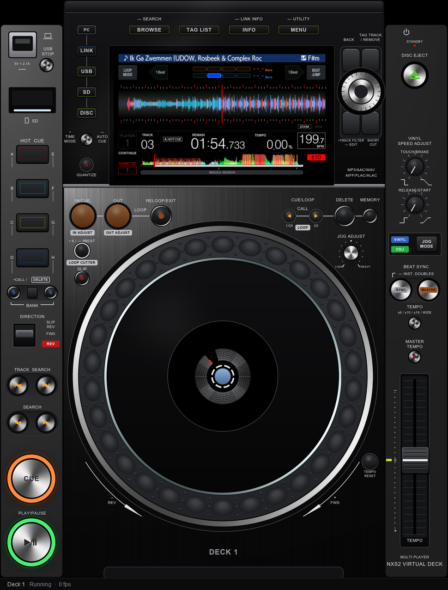

# Using the deck

## Keyboard

No controller needed: click a deck's window and play it from the keyboard.
Each window drives its own deck. The mouse is the touch screen.

| key | does | key | does |
|---|---|---|---|
| `Space` | PLAY/PAUSE | `C` | CUE (held, as on the deck) |
| `↑` / `↓` | turn the browse knob | `PgUp` / `PgDn` | ten rows at a time |
| `Enter` / `→` | push the knob: open a folder, load a track | `Esc` / `←` / `Backspace` | BACK |
| `,` / `.` | TRACK previous / next | `[` / `]` | SEARCH back / forward (held) |
| `-` / `=` | nudge slower / faster while held (`Shift` for more) | `Q` / `W` / `E` | LOOP IN / OUT / RELOOP |
| `B` | BROWSE | `M` | MENU (UTILITY) |
| `U` / `L` / `R` / `D` | USB / LINK / REKORDBOX / DISC source | `T` / `I` | TAG LIST / INFO |
| `S` | SYNC | `A` | MASTER |
| `K` | MASTER TEMPO | `P` | TEMPO RANGE |
| `V` | SLIP | `Z` | REVERSE |
| `J` | JOG MODE | | |

Not every key is mapped on the older players yet. On the XDJ-700, XDJ-1000 and
CDJ-900NXS only `U` (USB), `Enter` (the select knob's push) and `Space`
(PLAY) are: `U` and seven `Enter`s load the first track. The CDJ-900 also has
`↑` / `↓`, `,` (TRACK back), `[` / `]` (SEARCH), `B`, `T`, `I`, `M`, `L` and
`D`; `U` and four `Enter`s load the first track. `C` (CUE) and `Esc` (BACK)
are mapped, but the emulated CDJ-900 does not react to them yet.

<a id="virtual-deck"></a>

## The virtual deck app

<p align="center">

</p>

A full player drawn around the emulated screen instead of a bare window:
source and browse keys, the rotary selector, hot cue pads, the loop section,
CUE and PLAY, a jog with its centre display, the tempo fader. Everything on
it is drawn by the app itself; no photo, logo or artwork of the real unit is
used.

```sh
./start.sh --app          # or CDJ_APP=1 in cdj.conf; --no-app for the plain window
```

With two decks both stand side by side in one window. Closing the window, or
Ctrl-C, stops the decks.

`./start.sh --web` serves the same face as a web page with the screen live in
it: open the address it prints (`http://127.0.0.1:7210/`, deck 2 at
`/?deck=2`). The keys, the rotary selector, a tap on the screen and the
keyboard work as in the app; the jog, the tempo fader, the lamps and the sound
are not in the page yet. `--web lan` serves it on this PC's LAN address for a
tablet or a phone, with a key made at each start in the printed address;
without that key the page refuses. `--app --web` gives both.

<details>
<summary><b>Mouse and keyboard</b></summary>

| you do | the deck gets |
|---|---|
| click a key | the key, held for as long as the mouse button is |
| drag the jog round | the platter turning: the rim bends the track, the top plate is touch-sensitive |
| mouse wheel over the jog | a nudge |
| wheel over (or drag) the rotary selector, click its centre | turn, push |
| drag the tempo fader | the tempo slider |
| click the screen | a touch |
| type | the [keyboard](#keyboard) map, to the deck under the mouse |
| `F2` | the screen beside the face at full size, on/off |
| `F3`, or right-click the screen | the screen in a window of its own (resizable, `F11` full screen) |

</details>

<details>
<summary><b>Lamps</b></summary>

The lamps are the deck's own: PLAY, CUE, SLIP, MASTER TEMPO and the jog ring
light and blink from MAIN's panel-lamp frame, and the jog's centre display
turns with the firmware's own pointer. Keys whose report bit is decoded from
the firmware but not yet tried on a running deck carry a small amber ring;
keys with no known report bit (hot cues, BANK, QUANTIZE, TRACK FILTER, SHORT
CUT, the vinyl speed knobs, the needle strip) are drawn but do nothing.
Hovering a control says which is which in the status line.

</details>

<details>
<summary><b>A bigger screen</b></summary>

The NXS2's 7-inch screen is a small part of a tall deck, so a face that fits
a monitor shows it at about half size. `F3` opens a deck's screen in a
window of its own at any size (`F11` there for full screen); `F2` docks it
beside the face at its own 800 x 480 instead. The default is the decks
alone (`--screen face|dock|window|auto`, or `CDJ_APP_SCREEN`).

</details>

<details>
<summary><b>Stuck on "Waiting for the screen"</b></summary>

The screen comes from each deck's display board, a QEMU of its own. After
45 seconds without it the status strip says why, and the terminal prints the
end of that board's log (`bridge-gui-show1.log` in `/tmp`, or the system's
temp folder on Windows). `logs/app.log` records every attempt the app made
to reach each screen. Those two files are what to send with a bug report.
The emulator itself prints little; `CDJ_REPORT=1` brings back its exit reports
for diagnostics.

</details>

<details>
<summary><b>How it is built</b></summary>

Pillow draws the face and pygame-ce (SDL) puts it on screen; both are in
`requirements.txt`, which `./setup.sh` installs into `.venv/`. The window is
laid out in points and drawn in the display's own pixels, so on a Retina Mac
or a scaled Windows display the face is drawn at 2x (or whatever the
display's density is) rather than stretched. The face is drawn once per
window size with anti-aliasing and every lamp is a small pre-drawn image, so
a lamp or the jog costs almost nothing per frame and the time goes to the
screen: about 4 ms for an 800 x 480 frame at 2x on an Apple-silicon Mac, with
the window shown at the display's refresh rate (120 Hz there). The app talks
to the deck three ways:

- **the screen** comes from a frame file the display board writes whenever
  its picture changes (`CDJ_GUI_FRAME_FILE`, checked up to 120 times a
  second), so every frame the firmware draws is shown: with the
  `high_fps` mod about 70 a second while zoomed in on a playing track.
  QEMU's VNC server, the portable alternative, stops at 33 updates a second
  and is kept only as the fallback for an older build;
- **the touch screen and the keyboard** go over that VNC server (loopback
  only, one port per deck from 5921, or the next free one: the launcher
  tells the app which), straight into the display board's own
  touch and key handlers, exactly as with the plain window;
- **the drawn controls and the lamps** go through the controller relay, the
  same path and the same key table (`midi/cdj_actions.py`) as a MIDI
  controller, which can stay connected alongside.

</details>

## Service mode

```sh
./start.sh --service      # or CDJ_SERVICE=1 in cdj.conf; --no-service overrides it
```

This is the service manual's own diagnostic screen: on real hardware you get
it by holding **TEMPO RANGE** and **MEMORY** while powering the unit on, until
the Pioneer logo clears, and this flag does exactly that at boot. The screen
lists BUTTON, JOG, ENCODER, NEEDLE, SLIDER VOLUME, JOG TOUCH VOLUME and JOG
RELEASE VOLUME; press or move a control and its own row lights up, so it is a
live test of every input rather than the player screen.

Both keys release once the logo clears, so nothing stays held down and the
rest of the deck is otherwise normal.

By default every run boots from a shared, throwaway flash image, so nothing you
change in SERVICE MODE (or anywhere else) survives past Ctrl-C. With
`PERSIST=1` a deck keeps its own flash image between runs
(`extract/flash-<tag>.bin`), the same as a real unit's memory: a setting
changed in SERVICE MODE on a persistent deck stays changed.
