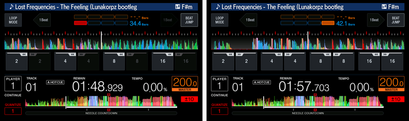

# beat_jump_long

Long beat jumps, as on the CDJ-3000: the 2 beat jumps jump 32 beats and the 4
beat jumps jump 64, back and forward. The 1, 8 and 16 beat jumps are unchanged.

*The BEAT JUMP row on a 200 BPM track, before and a second after a touch of
the backward 2 key: REMAIN goes from 1:48.9 to 1:57.7, a jump of 32 beats
(9.6 s) back less the time between the two frames.*

| | |
|---|---|
| knobs | `CDJ_MAIN_BEATJUMPLONG` |
| on / off | `1` / `0` |
| default | off |

**Turning it on.** `./setup.sh` asks about it in step 7 and saves the answer to
`cdj.conf`; `./setup.sh --reconfigure` asks again. For one run, set the knob to
`1` in the environment.

**What it changes.** One table in MAIN (`beatjumplong` in
`cdj2000nxs2/patch.py`). The player turns each beat jump key into the jump it
makes through a table of beat counts, one row per key. Stock firmware 1.87
already carries rows for 32 and 64 beats but never reaches them: the player
drops those keys, and the touch screen never sets them. The mod gives the 2 and
4 beat rows the counts of 32 and 64 instead, so the keys that already work make
the long jumps. That holds wherever the key comes from: the BEAT JUMP row of the
touch screen and a controller's beat jump. The keys still read 2 and 4 on the
screen. `python mods/patch_update.py C2KNXS2.UPD out.UPD beat_jump_long` writes
it into a real update (firmware 1.87).

Not tried on a real deck.

Back to the [mods](../../docs/mods.md).
