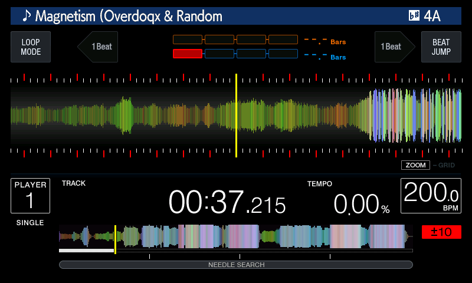

# cdj3000x

**Experimental.** Makes a
CDJ-2000NXS2 present itself to Serato DJ Pro as a CDJ-3000X, so that Serato
sends the richer data a 3000X gets: the browse list, the windowed detail
waveform and the 1200-column overview. On top of that the deck works out what a
3000X works out for itself, the beat boxes and the key, keeps Serato's detail
waveform on screen and moving while more of it arrives, and moves the browse
list ahead of Serato's answer. It needs no CDJ-3000X firmware file: a stock
3000X v1.40 answers Serato's authentication under an all-zero key, and so does
this mod (see the key, below).

*Serato DJ Pro playing a track on the deck: title and key at the top, the beat
boxes under them, Serato's detail waveform with the grid ticks in the centre,
the overview and the BPM below.*

| | |
|---|---|
| knobs | `CDJ_MAIN_X3000IDENT`, `CDJ_MAIN_X3000BCD`, `CDJ_MAIN_X3000HS`, `CDJ_MAIN_X3000IN`, `CDJ_MAIN_X3000OUT`, `CDJ_MAIN_X3000RXBUF`, `CDJ_MAIN_X3000RXVIEW`, `CDJ_MAIN_X3000SEGMENTS`, `CDJ_MAIN_X3000KEY`, `CDJ_MAIN_X3000BROWSE`, `CDJ_GUI_X3000KEEPWAVE`, `CDJ_GUI_X3000TRAINPOS` |
| on / off | `1` / `0` |
| default | off |
| apply-time inputs | `CDJ_3000X_PID` (hex, default `004e`) |

The one switch turns every knob on. Each knob can still be set on its own, for
example `CDJ_GUI_X3000TRAINPOS=0` to leave out the moving waveform; the parts
past the first seven need those seven on.

**Status.** With the identity and the handshake on, Serato DJ Pro recognises
the deck as a CDJ-3000X and connects to it: it no longer asks which deck to
assign, and it streams the control, overview, beat grid, detail waveform, album
art and library list reports. The deck shows the track's BPM and tempo, the
overview, the beat grid, the detail waveform and the browse list; BACK and push
to load work. There are no three-band waveforms: Serato has no message that
carries them, a 3000X takes them only from rekordbox. Not tried on a real deck.

| part | state |
|---|---|
| USB identity: product id, strings, bcdDevice | done |
| Serato authentication | done. Serato authenticates the 3000X over the same HID handshake the NXS2 already runs, not a separate MIDI channel: it answers the deck's hello with a host-identity message (stage 0x30) and the deck replies with its own identity (stage 0x31). `x3000hs` sends that reply and marks the deck authenticated. No key is involved in this exchange. (A MIDI SysEx certificate path also exists in the 3000X firmware, but Serato does not use it for this.) |
| 1024-byte HID Output report | done. Serato sends the detail waveform only to a deck whose report descriptor declares a 1024-byte Output report. `x3000out` declares it (the descriptor keeps its length); the endpoint stays at 64 bytes, so each report arrives as 16 packets of one transfer. `x3000rxbuf` has the HID OUT task read the whole transfer into a 1024-byte buffer of its own, and `x3000rxview` gives the stock handlers the first 64 bytes of each report in their own buffer, so they see what a 64-byte read gave them |
| Report translation: the 3000X's larger reports into the NXS2's handlers | done for the library list, the control report, the overview, the beat grid and the detail waveform. The 3-band waveforms are not handled: the 3000X takes them only from rekordbox's HID mode, and Serato DJ Pro 4.0.9 has no message that carries them |
| Hot cues, memory cues and loops | done. The hot cues pass to the NXS2 as they come; the memory cue and loop list is rewritten |
| Beat boxes (`x3000segments`) | the boxes fill from the track's grid (the picture above) |
| Key (`x3000key`) | the key shows in the title bar (the picture above). Following Serato's key shift is partial |
| Centre waveform kept on screen and moving (`x3000keepwave`, `x3000trainpos`) | the strip stays drawn through an update and its position moves with the playhead; the time readout and the minimap still hold for the length of an update |
| Browse list ahead of Serato (`x3000browse`) | the list moves ahead of Serato's answer |

**The key.** The authentication key is 128 bits and the same in every unit of a
model, but the CDJ-3000X v1.40 package does not contain it: the file its loader
reads is absent, so a stock 3000X answers Serato under a 16-byte all-zero key.
The answer routine does the same, so the authentication part needs no key file
and no `CDJ_3000X_FW`. If a unit does carry a key file and Serato enforces it,
the all-zero slot in the patched image can be filled from that unit's own file;
`keysource.py` is the reader for that case, and a key placed there would live
only in the update you patch for your own deck, never here.

**What it changes.** Table patches and hooks, found by the bytes around them and
checked against what the 1.87 firmware holds before anything is written:

- `x3000ident` rewrites the device descriptor's product id (the 3000X's own
  fallback `0x004E`, or `CDJ_3000X_PID`) and the manufacturer, product, MIDI
  and HID strings to "AlphaTheta Corporation", "CDJ-3000X", "CDJ-3000X MIDI" and
  "CDJ-3000X HID". The vendor id stays `0x2B73`. The driver sends a string as
  long as its first byte says, so the shorter names leave the table's layout
  alone. The second device descriptor in the firmware, the vendor-class one the
  Serato path does not use, keeps its identity.
- `x3000bcd` replaces the routine that stamps the firmware version into
  bcdDevice with the constant `0x0140`, the 3000X's "1.40".
- `x3000in` sends the deck's state report in the 3000X layout: the hot cue
  pads and the analog block (browse encoder, tempo, jog, needle) one byte
  further on, and the two reverse bits the 3000X way round. It is hooked in the
  HID IN task, where the report is taken from the sender's queue, because
  everything before that queue runs at boot. Without it Serato never sees the
  encoder turn that selects a deck, and plays every track backwards.
- `x3000out` makes the HID report descriptor's Output report 1024 bytes
  instead of 64. The descriptor cannot grow, so the Output block's Physical
  Minimum 0 is written as a zero-length item to make room for the longer
  Report Count; its length and every `wDescriptorLength` stay as they are.
- `x3000rxbuf` hooks the HID OUT task in front of its read call: the read goes
  to a 1024-byte buffer at the end of the free range the routines are placed
  in, and asks for 1024 bytes. The firmware's own pipe reader keeps taking
  64-byte packets until the length is reached or a short packet ends the
  transfer, so it returns the whole report.
- `x3000rxview` hooks the task after the read returns: it copies the report's
  first 64 bytes into the task's own buffer and caps the count at 64, so the
  report router and the handshake code run exactly as on a 64-byte read. It
  also rewrites the list Serato shows on the deck (the prompt, the deck choice and
  the library), which a 3000X gets as records in one report or in fragments,
  into the NXS2's record form and hands it to the firmware's own report
  handling, so the deck draws it. The NXS2 list has a header and eight rows;
  Serato sends a header and up to eleven rows with the cursor four rows down, so
  the eight rows from four above the cursor are shown. A track row gets its BPM
  and key as text; a major key is left out, because which key number is which
  is not known. Serato's control report gets the same treatment: its BPM,
  tempo, cue point and second time sit one byte further on than the NXS2 reads
  them and are moved back, so the deck shows the right BPM and tempo. Serato's
  elapsed time is negative before the track starts, which the NXS2 cannot read
  (it would show 0:00.000 for both times); it is shown as 0:00.000. The loop
  size is shown only for a beat loop of a size the NXS2 can show (1/128 to 512
  beats); any other loop shows as no loop. Quantize passes through as Serato
  sends it. The overview
  and the beat grid arrive in fragments of 1018 bytes and are handed to the
  firmware's report handling whole, cut at the end of the message; the detail
  waveform arrives as a track length and then windows of 19 points streamed
  ahead of the playhead, and goes into the firmware's own detail buffer. The
  stock firmware sends that whole buffer to the display each time and the
  display takes in no deck state until it has gone through, so a train of only
  the new chunks is sent instead, about every 1,500 points (10 s of track). The
  first 67 s of a track arrive in a few seconds, and while it plays the detail
  stays at least 57 s ahead of the playhead. The hot cues
  (type 0x30: the track length and eight slots of kind, colour, minutes,
  seconds and ms) are already in the layout the NXS2 reads, colours on the same
  wheel of 64, and go to it as they come. The memory cues and loops (type
  0x2d) are the same length, a count and up to ten records, each one byte
  longer on the 3000X: a kind (1 a memory cue, 2 and 3 the others) in front of
  the colour and the time. They are rewritten in the NXS2's form, the colour
  with bit 7 set for anything but a memory cue, as the NXS2 reads it. Records
  of another kind are left out, a colour outside 1 to 8 becomes red as on the
  3000X, and a count of 0 or above ten is an empty list. A loop arrives as one
  position, so it shows as a marker at its start: the NXS2's list can hold a
  loop's end, but nothing in Serato's message gives it.

The rest are hooks that do what a 3000X does on its own, or that smooth over
the way Serato streams:

- `x3000segments` fills the beat boxes at the top of the screen. The NXS2 draws
  them from four fields of the control report that a CDJ-3000X does not get,
  because a 3000X works the beat out itself from the beat grid and the playing
  position. The hook does the same: after `x3000rxview` has put the control
  report in the NXS2 layout, it finds the beat the position is in with the grid
  Serato sends and writes the length of the bar and the position in it into the
  report before the firmware reads it. The second row of boxes and the phase
  meter stay empty.
- `x3000key` shows the key of the loaded track. Serato sends a 3000X the key as
  its own message type, which the NXS2 ignores; the deck does take a key as the
  musical key message of its report framework, so a hook on the entry of the
  report router, after the handshake's, rewrites Serato's message into that one.
  Serato writes the key as Camelot text ("1A", "11A") or an empty string. The
  firmware's parser takes the Camelot numbers 1 to 9 and the note names, but not
  10 to 12, so those six become the note names the same keys have on the
  Camelot wheel (10A Bm, 10B D, 11A F#m, 11B A, 12A C#m, 12B E). Text that is
  not ASCII leaves the key empty. The colour index of the message is left 0;
  Serato sends none.
  The key readout follows Serato's key shift. Serato sends the key text once
  per load, but the control report it sends 64 times a second carries the key
  (as an index into the 3000X's own key table) and the shift in semitones, and
  the 3000X shows the key moved by the shift. The hook does the same: whenever
  key or shift change it sends the shifted key as its Camelot code, a semitone
  being 7 steps round the wheel (9A shifted +2 is 11A, shown as F#m). The
  message has no room for the offset, so the deck shows the shifted key, not
  "+2".
- `x3000keepwave` (display firmware 1.81) stops the centre waveform going black
  every time Serato sends more of it. The display hides the strip from the first
  chunk of a detail update until the beat grid that follows it is in; the patch
  leaves out the two stores that hide it, so the old picture stays until the new
  one is complete.
- `x3000trainpos` (display) keeps the centre waveform moving through an update.
  While an update is on the link the display holds the waveform's position for
  about 78 ms (around 4 renders); the hook moves the position on from the
  display's own clock for as long as the update is on the link.
- `x3000browse` moves the browse list as soon as the encoder turns. Serato
  answers each step with a new page 38 to 64 ms later (median 51), so on its own
  the list follows the encoder that much late. Serato sends 11 rows and the deck
  shows eight, so the rows a step brings on screen are mostly rows the deck
  already has: the hook, in the HID IN task after `x3000in`, predicts Serato's
  next page from the last one and the step, shows it at once, and lets Serato's
  answer correct it. A new top row on an upward step stays blank until the
  answer fills it in. It shows at most one list every 30 ms and drops a step
  Serato has not answered after 150 ms (at the top or the bottom of a crate
  Serato sends nothing).

The real 3000X's product id is one of `0x004E` to `0x0051` and is not in any
firmware file; if you have read it off a deck, set `CDJ_3000X_PID`.

**In the firmware.** `python mods/patch_update.py C2KNXS2.UPD out.UPD cdj3000x`
writes them into a real update (firmware 1.87). An image that already carries
them is left as it is.

Not tried on a real deck.

Back to the [mods](../../docs/mods.md).
