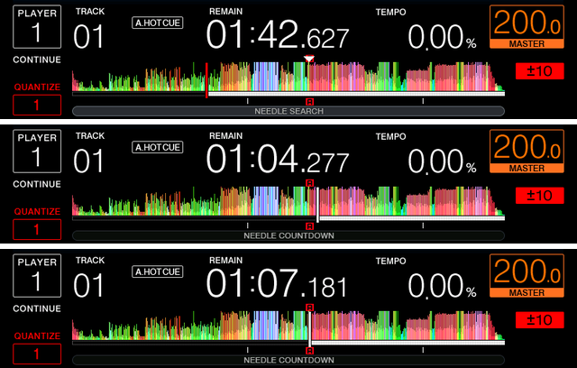

# gate_cue

Gate Cue, as on the CDJ-3000: while the deck is paused, a hot cue pad plays
from its cue only for as long as it is held. Letting go of the pad sends the
deck back to the cue and pauses it there. A pad pressed while the deck is
playing behaves as before: the deck jumps to the cue and plays on.

Stock firmware 1.87 has no gate. A hot cue recalled while paused starts the
deck, and it keeps playing after the pad is released.

*Paused (top); pad A held, the deck plays from hot cue A (middle); pad let
go, the deck is back on the cue and paused there (bottom, four seconds after
the release).*

| | |
|---|---|
| knobs | `CDJ_MAIN_GATECUE`, `CDJ_MAIN_GATECUEPRESS` |
| on / off | `1` / `0` |
| default | off |

**Turning it on.** `./setup.sh` asks about it in step 7 and saves the answer to
`cdj.conf`; `./setup.sh --reconfigure` asks again. For one run, set both knobs
to `1` in the environment.

**What it changes.** Two MAIN hooks (`gatecue` and `gatecuepress` in
`cdj2000nxs2/patch.py`). One sits at the entry of the hot cue recall, which
the pad pass calls when a pad whose slot holds a cue goes down: if that pad is
down on the deck's own panel and the deck is paused, it notes the slot; if the
deck is playing, it forgets any slot noted before. The other sits in the pad
pass, which runs on every pass of the player task: once the noted slot's pad
reads up, it forgets the slot and runs the CUE key's own return to the cue
with that slot instead of the main cue, which posts the transport command
that returns to a cue and stops there. Only the pads of the deck's own panel
open a gate; a recall that comes from anywhere else is left alone.
`python mods/patch_update.py C2KNXS2.UPD out.UPD gate_cue` writes both into a
real update (firmware 1.87).

From pause, holding pad A plays from its cue and letting go returns to the cue
and stops there (as after CUE), rather than paused where it was. Not tried on a real deck.

Back to the [mods](../../docs/mods.md).
