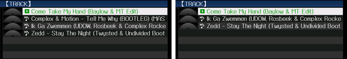

# track_filter

Filters the track list on the XDJ-700 by BPM. Hold **INFO** for about two
seconds while the BROWSE screen shows a USB track list: the list then shows
only the tracks within 6 % of the BPM of the track loaded on the deck. Hold
INFO again and the whole list is back. A deck with nothing loaded has no BPM to
filter on, so the first hold does nothing until a track is loaded.

*The track list of the test stick with a 205 BPM track loaded, before and after
a hold of INFO: the 190 BPM track is gone.*

| | |
|---|---|
| knob | `CDJ_MAIN_TRACKFILTER` |
| on / off | `1` / `0` |
| default | off |

**Turning it on.** `./setup.sh --model xdj700` asks about it in step 7 and saves
the answer to `cdj.conf`; `./setup.sh --reconfigure` asks again. For one run,
`CDJ_MAIN_TRACKFILTER=1 ./start.sh --model xdj700`. A short press of INFO still
opens the INFO page, and a long press anywhere but the BROWSE screen still opens
LINK INFO. The INFO tab on the touch screen is the same key to the firmware; that hold was not tried.

**What it changes.** The XDJ-700 firmware already carries the track filter of
the CDJ-2000NXS2: the condition store, the per-row test and the list builders
that hide the rows that fail it. Only the screen and the key that drive it were
left out. The mod adds the key: one routine, placed in the room of four kernel
debug-shell handlers nobody calls, takes the INFO key's slot in the key table
and, on a long press in the BROWSE screen, calls the firmware's own filter
switch and BPM condition for the USB track list and asks the browser to read
the list again. Every address the routine uses is found in the firmware by its
code, so it applies to firmware 1.15 and refuses a version it does not
recognise. `python mods/patch_update.py --model xdj700 XDJ700.UPD out.UPD
track_filter` writes it into a real update.

**Status.** In the emulator, four tracks on the stick and a track of 205 BPM
loaded: each hold alternates the list between four rows and three (the track
far from 205 BPM drops out), in two runs, and a run on the stock firmware shows
the LINK INFO page for the same hold and never changes the list. The deck has no
lamp or text for it: the missing rows are the only sign that the filter is on.
Not tried on a real XDJ-700.

Back to the [mods](../../docs/mods.md).
